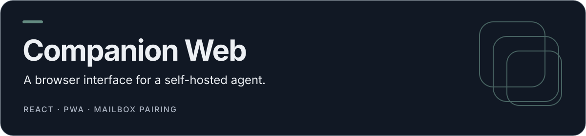

<p align="center">
  
</p>

# Companion Web

A mobile-first web companion for [Hermes Agent](https://hermes-agent.nousresearch.com/), built with React 19, TanStack Start, Tailwind and Zustand. It combines pairing, chat, a notification shade, device controls and action review in a browser interface.

[Features](#features-and-limits) · [Develop](#development) · [Host plugin](#connect-a-host) · [Checks](#checks)

## Features and limits

| Surface       | What to expect                                                                         |
| ------------- | -------------------------------------------------------------------------------------- |
| Pairing       | Six-character code and LAN/private-network discovery                                   |
| Chat          | Sessions and tool chips; configured provider requests or a local fallback              |
| Device        | UI state plus available browser APIs; native control requires a compatible paired node |
| Notifications | In-app shade and forwarding over the companion mailbox                                 |
| Review        | In-app approval cards for supported sensitive actions                                  |

Browser device state includes demo/virtual values. Changing a control in the UI does not prove that Android system settings, calls, SMS or a real notification listener changed. Browser support and permission grants vary. Pairing, sessions and shade state are persisted by the client store; this app is not Tally's server-only finance model.

## Development

Use Node 22 and npm with the committed lockfile:

```sh
git clone https://github.com/coding-nyx/hermes-companion-web.git
cd hermes-companion-web
npm ci
npm run dev
```

The development script binds `0.0.0.0:8080`; select the intended development network before running it. The repository contains platform auth/database scaffolding. Configure the intended environment rather than assuming every hosted deployment runs without auth or storage.

The optional `XAI_API_KEY` belongs only in a protected server environment. Without provider configuration, local fallback responses are not live model results. Never place server credentials in `VITE_*` variables or browser storage.

## Connect a host

Use the separate [Companion platform plugin](https://github.com/coding-nyx/hermes-companion-plugin). It provides `/companion/pair`, `/companion/inbox` and `/companion/outbox`, normally on port **8642**. Read its installation and private-listener configuration before changing a Hermes host.

The [current Android app](https://github.com/coding-nyx/hermes-companion-app) uses a different bundled relay, normally port **9120**. Its pairing protocol is not interchangeable with this web mailbox. The [older Android prototype](https://github.com/coding-nyx/hermes-companion) is archived.

## Checks

```sh
npm run typecheck
npm test
npm run lint
npm run build:dev
```

`npm run build` also invokes `db:migrate`; it can perform database work when configured. Review the migration environment before using the production build command. A UI demo or local fallback is not certification of a live Hermes host or phone-control integration.

## Source map

- `src/components/`: chat, device and companion views.
- `src/lib/hermes/`: client store, device actions and companion contracts.
- `public/hermes-plugin/`: bundled plugin copy; the separate plugin repository is the host-source reference.
- `server/`, `src/lib/auth/`, `migrations/`: platform server/auth/database support.
- `scripts/`: environment, build and browser-check helpers.

No top-level license file is present. The existing platform shell and branding remain part of the project.
